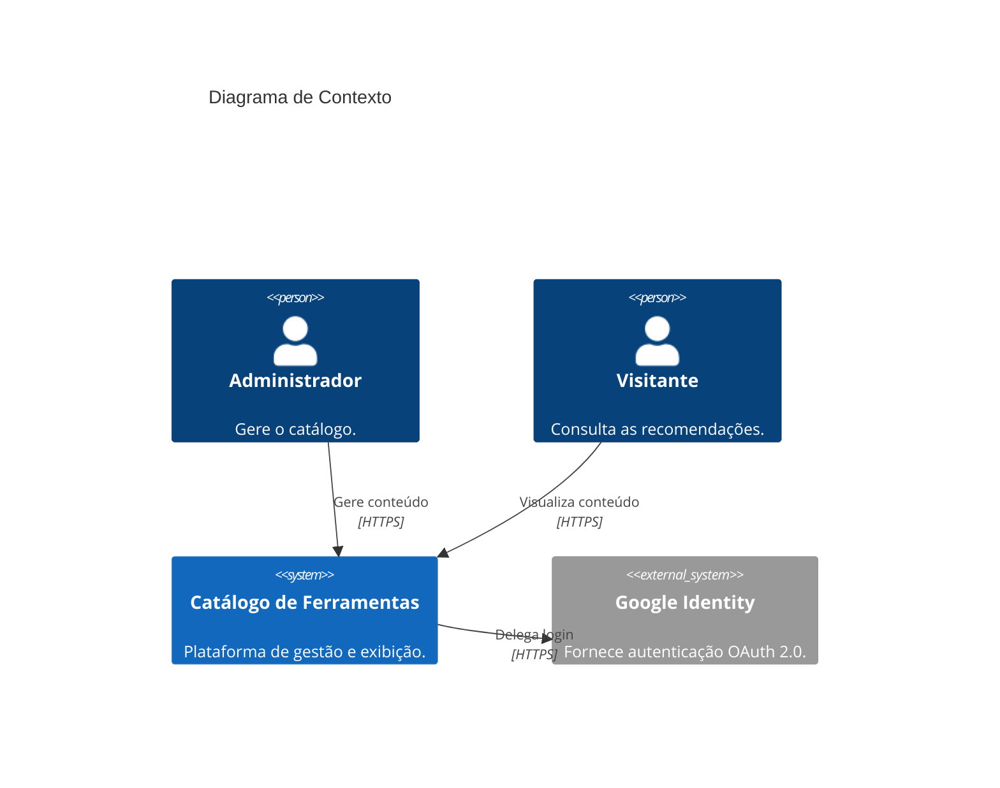

# Catálogo de Ferramentas Recomendadas 🛠️

## 1. Visão Geral

Plataforma web responsiva, acessível e segura para catalogação, organização e recomendação de ferramentas úteis para o dia a dia de profissionais de tecnologia.

**Tecnologias Utilizadas:**

- **Front-end:** HTML5 (Semântico), CSS3 (Variáveis, Grid, Flexbox) e JavaScript (ES6 Modules).
- **Back-end / BaaS:** Firebase (Authentication, Firestore Database).
- **Design:** UI Minimalista (Dark mode por defeito) focado em acessibilidade.

---

## 2. Arquitetura do Sistema (Modelo C4)

### Nível 1: Diagrama de Contexto

